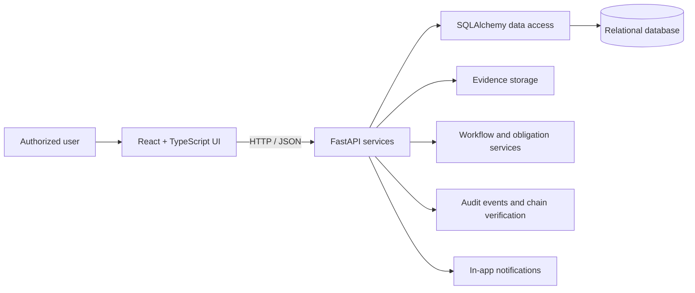

# PRAVAAH Architecture Overview

## Purpose

PRAVAAH is an academic prototype for structured approval workflow management, evidence review, compliance obligation tracking, readiness assessment, and audit traceability. It is not an official AICTE service and does not issue regulatory approvals.

## High-level design

## Main components

- **Frontend:** React, TypeScript, and Vite provide the role-oriented user interface.
- **API layer:** FastAPI exposes application and compliance operations.
- **Persistence:** SQLAlchemy manages relational records; Alembic manages schema migrations.
- **Workflow services:** Application transitions, evidence review, obligations, undertakings, and readiness snapshots.
- **Evidence integrity:** Stored file digests are checked on download to detect changed content.
- **Audit integrity:** Linked audit records use previous-hash and event-hash fields, with an endpoint to verify the chain.
- **Notifications:** The supported notification channel is in-app. External email/SMS delivery is not currently represented as enabled.

## Representative workflow

1. An authorized user creates or reviews an application record.
2. Supporting evidence and policy metadata are associated with the workflow.
3. Reviewers record findings and track outstanding obligations.
4. Readiness snapshots and rule-based recommendations help surface items needing attention.
5. Authorized administrators inspect audit history and run the audit-chain verification endpoint.

## Design boundaries

- Role and regional authorization rules constrain access to supported operations.
- AI-style recommendations must not be treated as legally binding determinations.
- A valid hash chain establishes consistency of the recorded chain, not the truth or completeness of every underlying event.
- Integration with official AICTE systems requires separate authorization and approved interfaces.

See the root [README](../README.md) for setup, capabilities, testing evidence, and security notes.
